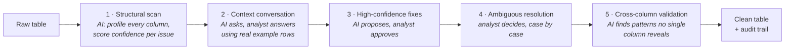

# SpotterPrep: An AI Data Preparation Agent

An AI that automatically cleans enterprise data sounds useful. It isn't.

When an AI cleans a table without explanation, analysts spend their time auditing the output instead of cleaning the data. The work doesn't go away. It shifts from cleaning to verification. Net time saved: near zero. Trust in the output: low. Adoption: zero.

**SpotterPrep is built on a different thesis:** the AI should do the computation, and the analyst should own every non-trivial decision. It scans first and asks before it touches anything. It shows concrete example rows, not statistics. It proposes fixes only after the analyst has answered the questions that make those fixes safe. And there is a hard list of things it will never do automatically (monetary fields, PII, physics violations, accounting entries) regardless of confidence score.

The result: analysts who feel like *they* cleaned the data, with AI doing the work.

> **Validated at scale:** 4.4M rows · 5 enterprise datasets · 1,880 columns · ~19 GB · 10 Snowflake tables
> **Try it now:** open [`prototype/index.html`](prototype/index.html) in a browser. No setup needed.

---

## How it works

Cleaning runs in five iterations. Each one has a clear owner: the AI, the analyst, or both.



| Iteration | Who decides | Score impact | Where it lives |
|---|---|---|---|
| 1. Structural scan | AI | None, by design | [`spotterprep/iteration1_confidence.py`](spotterprep/iteration1_confidence.py) |
| 2. Context conversation | Analyst, prompted by AI (Claude) | None, by design | [`spotterprep/iteration2_context.py`](spotterprep/iteration2_context.py) |
| 3. High-confidence fixes | AI proposes, analyst approves | Largest gain | Decision-tree rules in each dataset's `clean_raw()` |
| 4. Ambiguous resolution | Analyst | Moderate gain | Decision-tree rules in each dataset's `clean_raw()` |
| 5. Cross-column validation | AI | Final gain | [`spotterprep/iteration5_cross_column.py`](spotterprep/iteration5_cross_column.py) |

Every transformation is written to an append-only audit log ([`audit_logger.py`](spotterprep/audit_logger.py)) and re-scored after each iteration ([`quality_scorer.py`](spotterprep/quality_scorer.py)).

Full model: [`docs/03_five_iteration_model.md`](docs/03_five_iteration_model.md)

### What the AI never does on its own

| Data type | Rule | Why |
|---|---|---|
| Monetary | Never imputed; nulls flagged | Fabricating revenue is not a data quality fix |
| PII | Never imputed; trimmed only | Personal data cannot be invented |
| Physics violations | Flagged, never corrected | A sensor reading where P > V×I is a real fault, not a typo |
| Accounting imbalances | Escalated to a human | Debit ≠ credit needs finance review |

---

## Results

Recorded on the full-scale run across all five datasets. Quality is scored at the row level across five weighted dimensions ([methodology](docs/04_quality_framework.md)).

| Dataset | Domain | Rows | Columns | Raw score | Clean score |
|---|---|---|---|---|---|
| CUSTOMER_ORDERS | B2B SaaS / e-commerce | 100,000 | 200 | 54.1 (D) | 91.2 (A) |
| IOT_TELEMETRY | Industrial IoT | 500,000 | 300 | 68.3 (D) | 97.4 (A) |
| HR_WORKFORCE | Enterprise HR | 800,000 | 400 | 50.5 (F) | 87.7 (B) |
| FINANCIAL_LEDGER | General ledger | 1,000,000 | 480 | 63.2 (C) | 97.3 (A) |
| PRODUCT_CATALOG | Global e-commerce, 8 languages | 2,000,000 | 500 | 59.3 (D) | 96.2 (A) |
| **Total** | | **4,400,000** | **1,880** | **59.1 (D)** | **93.9 (A)** |

HR stays at Grade B on purpose. Contractors legitimately have no `bonus_target` or `equity_grant`, and SpotterPrep preserves those nulls instead of inventing payroll data.

---

## Repository map

```
spotterprep/
├── spotterprep/        The cleaning engine: one module per iteration, plus scoring and audit
├── agent/prompts/      System prompt and conversation rules for the conversational agent
├── data_generation/    Five synthetic enterprise datasets with issues injected at known rates
├── loaders/            Snowflake loader (staged PUT + COPY INTO) and load orchestration
├── sql/                Ready-to-run validation and before/after quality queries
├── prototype/          Interactive UI prototype (single HTML file)
└── docs/               Design docs, numbered in reading order
```

### Reading order

| # | Document | Read it for |
|---|---|---|
| 01 | [Product requirements](docs/01_product_requirements.md) | The problem, target user and scope |
| 02 | [AI interaction design](docs/02_ai_interaction_design.md) | The human-AI control model and UX rationale |
| 03 | [Five-iteration model](docs/03_five_iteration_model.md) | How each iteration works and what it may do |
| 04 | [Quality framework](docs/04_quality_framework.md) | The five scoring dimensions and weights |
| 05 | [Architecture](docs/05_architecture.md) | Data flow and key engineering decisions |
| 06 | [PII policy](docs/06_pii_policy.md) | What data may reach the LLM, and how it is sanitized |
| 07 | [Postmortem: schema inference bug](docs/07_postmortem_schema_inference.md) | How a substring match broke 400+ columns, and the fix |
| 08 | [Engineering handoff](docs/08_engineering_handoff.md) | Full implementation detail for engineers |

---

## Quickstart

```bash
pip install -r requirements.txt

# 1. Generate the five datasets into data/ (about 19 GB; 45 to 90 minutes at full size)
python data_generation/generate_all.py

# 2. Score and validate a dataset
python -c "
import pandas as pd
from spotterprep.iteration1_confidence import score_issues, print_confidence_report
df = pd.read_csv('data/raw/dataset1_customer_orders.csv', nrows=10_000)
print_confidence_report(score_issues(df, table_name='CUSTOMER_ORDERS', pk_column='order_id'))
"

# 3. Run the AI context conversation (needs an Anthropic API key)
export ANTHROPIC_API_KEY=your_key
python spotterprep/iteration2_context.py data/raw/dataset1_customer_orders.csv --nrows 20000

# 4. Optional: load everything into Snowflake
cp .env.example .env   # fill in your Snowflake details
python loaders/load_to_snowflake.py --dry-run --dataset 1   # preview DDL, no connection
python loaders/load_to_snowflake.py                         # load all 10 tables
```

To try it quickly, lower `N` at the top of any file in `data_generation/` to a few thousand rows.

---

## Tech stack

Python · pandas · numpy · Faker · Claude (Anthropic API) · Snowflake (`PUT` + `COPY INTO`) · Claude Code for implementation

Architecture, cleaning logic and the quality framework were designed first; Claude Code was used to implement them.

---

## About

Built by [Peeyush Vardhan](https://github.com/peeyush-vardhan) as a hands-on prototype of an agentic, human-in-the-loop data preparation workflow.

Released under the [MIT License](LICENSE).
