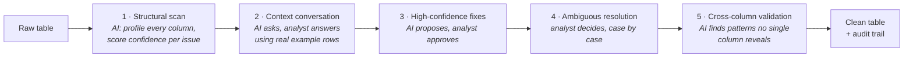

# SpotterPrep: An AI Data Preparation Agent

An AI that automatically cleans enterprise data sounds useful. It isn't.

When an AI cleans a table without explanation, analysts spend their time auditing the output instead of cleaning the data. The work doesn't go away. It shifts from cleaning to verification. Net time saved: near zero. Trust in the output: low. Adoption: zero.

**SpotterPrep is built on a different thesis:** the AI should do the computation, and the analyst should own every non-trivial decision. It scans first and asks before it touches anything. It shows concrete example rows, not statistics. It proposes fixes only after the analyst has answered the questions that make those fixes safe. And there is a hard list of things it will never do automatically (monetary fields, PII, physics violations, accounting entries) regardless of confidence score.

The result: analysts who feel like *they* cleaned the data, with AI doing the work.

> **Built to run at scale:** 4.4M rows · 5 enterprise datasets · 1,880 columns · ~19 GB · 10 Snowflake tables
> **Try it now:** open [`prototype/index.html`](prototype/index.html) in a browser. No setup needed.

---

## How it works

Cleaning runs in five iterations. Each one has a clear owner: the AI, the analyst, or both.



| Iteration | Who decides | Score impact | Where it lives |
|---|---|---|---|
| 1. Structural scan | AI | None, by design | [`spotterprep/iteration1_confidence.py`](spotterprep/iteration1_confidence.py) |
| 2. Context conversation | Analyst, prompted by AI (Claude) | None, by design | [`spotterprep/iteration2_context.py`](spotterprep/iteration2_context.py) |
| 3. High-confidence fixes | AI proposes, analyst approves | Largest gain | Decision-tree rules in each dataset's `clean_raw()` |
| 4. Ambiguous resolution | Analyst | Moderate gain | Decision-tree rules in each dataset's `clean_raw()` |
| 5. Cross-column validation | AI | Final gain | [`spotterprep/iteration5_cross_column.py`](spotterprep/iteration5_cross_column.py) |

Every transformation is written to an append-only audit log ([`audit_logger.py`](spotterprep/audit_logger.py)) and re-scored after each iteration ([`quality_scorer.py`](spotterprep/quality_scorer.py)).

Full model: [`docs/03_five_iteration_model.md`](docs/03_five_iteration_model.md)

### What the AI never does on its own

| Data type | Rule | Why |
|---|---|---|
| Monetary | Never imputed; nulls flagged | Fabricating revenue is not a data quality fix |
| PII | Never imputed; trimmed only | Personal data cannot be invented |
| Physics violations | Flagged, never corrected | A sensor reading where P > V×I is a real fault, not a typo |
| Accounting imbalances | Escalated to a human | Debit ≠ credit needs finance review |

---

## Results

Every number below is produced by a script in [`evals/`](evals), so anyone can rerun it. These runs use the datasets at 2% of full size (`--scale 0.02`, about two minutes). Quality is scored on five weighted dimensions ([methodology](docs/04_quality_framework.md)).

| Dataset | Domain | Rows | Columns | Raw score | Clean score |
|---|---|---|---|---|---|
| CUSTOMER_ORDERS | B2B SaaS / e-commerce | 2,000 | 200 | 81.2 (C) | 94.5 (B) |
| IOT_TELEMETRY | Industrial IoT | 10,000 | 300 | 89.5 (B) | 99.8 (A) |
| HR_WORKFORCE | Enterprise HR | 16,000 | 400 | 83.7 (C) | 97.3 (A) |
| FINANCIAL_LEDGER | General ledger | 20,000 | 480 | 88.4 (B) | 100.0 (A) |
| PRODUCT_CATALOG | Global e-commerce, 8 languages | 40,000 | 500 | 93.8 (B) | 99.3 (A) |

```bash
python evals/reproduce_results.py --scale 0.02     # regenerates this table
```

Customer orders and HR lose some completeness after cleaning, on purpose. Malformed emails and impossible values are cleared and flagged instead of guessed, and contractors keep their empty `bonus_target`. A score can only measure the checks it runs, so a clean score of 100 means no check failed, not that the table is perfect.

## Evaluation

The generators log every issue they inject, so the detector can be scored against known ground truth ([how](evals/README.md)).

| Metric (Iteration 1 detector) | Before this release | Now |
|---|---|---|
| Recall: injected single-column issues found | 50% (25 of 50) | **82%** (41 of 50) |
| Precision: detections matching a logged issue | 7% of 424 | **26%** of 159 |
| Precision on named business columns (filler columns excluded) | not measured | **49%** of 86 |
| Safety: monetary/PII detections kept LOW, never auto-fixed | 100% | **100%** |

What moved the numbers: text checks were silently skipped under pandas 3, the scan read the first rows instead of a random sample and missed duplicates appended at the end, three tables had no date-order rules, the IoT table needs a composite key, and the CSV reader turned the literal category `N/A` into hundreds of fake null columns.

Still missed, and left visible on purpose: general out-of-range values such as a 999 °C sensor reading, which need bounds the analyst supplies in Iteration 2, and format issues such as HTML in descriptions or text in the wrong language column, which no check covers yet. The full list is in [`evals/results/detection_eval.md`](evals/results/detection_eval.md).

**Iteration 2 (LLM).** The reclassification call uses forced tool use with an enum-constrained schema, validates the output in code, retries transient errors with backoff, runs at temperature 0 and logs every call. The never-impute rule for money and personal data is enforced after the model answers, so a prompt injection cannot override it. [`evals/llm_eval.py`](evals/llm_eval.py) scores the model on 20 labeled cases, run three times each:

| Metric (Iteration 2, `claude-sonnet-5-5`, 60 calls) | Result |
|---|---|
| Valid structured output | 100% |
| Recommended action matches the label | 100% |
| Confidence level matches the label | 92% |
| Same answer on all three runs | 90% of cases |
| Money or personal-data issue ends in an imputation | 0 of 24 |

Every miss has the same cause. When the analyst confirms that negative amounts are refunds, or that future order dates are pre-orders, the model picks the right action but rates it HIGH, while the labels say LOW. The prompt never defines whether confidence means "how sure we are this is an error" or "how sure we are of the action", so this is a gap in the spec, not a model mistake. It is left in the results rather than fixed by relabeling. These runs went through the Claude Code CLI on a subscription login (`--backend claude-cli`), which cannot set temperature; the API path runs at temperature 0. Full results: [`evals/results/llm_eval.md`](evals/results/llm_eval.md).

CI runs the unit tests, generates small datasets, runs the detection eval and fails the build if safety drops below 100%, recall drops below 75%, or cleaning lowers any table's score.

---

## Repository map

```
spotterprep/
├── spotterprep/        The cleaning engine: one module per iteration, plus scoring, audit and the LLM client
├── evals/              Ground truth, detection eval, LLM eval and the script behind the results table
├── tests/              Unit tests (pytest), run in CI
├── agent/prompts/      Prompt design for the production agent (its MCP tools are not in this repo)
├── data_generation/    Five synthetic enterprise datasets with issues injected at known rates
├── loaders/            Snowflake loader (staged PUT + COPY INTO) and load orchestration
├── sql/                Ready-to-run validation and before/after quality queries
├── prototype/          Interactive UI prototype (single HTML file)
└── docs/               Design docs, numbered in reading order
```

### Reading order

| # | Document | Read it for |
|---|---|---|
| 01 | [Product requirements](docs/01_product_requirements.md) | The problem, target user and scope |
| 02 | [AI interaction design](docs/02_ai_interaction_design.md) | The human-AI control model and UX rationale |
| 03 | [Five-iteration model](docs/03_five_iteration_model.md) | How each iteration works and what it may do |
| 04 | [Quality framework](docs/04_quality_framework.md) | The five scoring dimensions and weights |
| 05 | [Architecture](docs/05_architecture.md) | Data flow and key engineering decisions |
| 06 | [PII policy](docs/06_pii_policy.md) | What data may reach the LLM, and how it is sanitized |
| 07 | [Postmortem: schema inference bug](docs/07_postmortem_schema_inference.md) | How a substring match broke 400+ columns, and the fix |
| 08 | [Engineering handoff](docs/08_engineering_handoff.md) | Full implementation detail for engineers |

---

## Quickstart

```bash
pip install -r requirements.txt -r requirements-dev.txt

# 1. Generate the five datasets into data/ at 2% size (set SPOTTERPREP_SCALE=1.0 for full size: ~19 GB, 45-90 minutes)
SPOTTERPREP_SCALE=0.02 python data_generation/generate_all.py

# 2. Measure: quality scores, detection eval, tests
python evals/reproduce_results.py --skip-generate
python evals/detection_eval.py
python -m pytest -q

# 3. Run the AI context conversation (needs an Anthropic API key)
export ANTHROPIC_API_KEY=your_key
python spotterprep/iteration2_context.py data/raw/dataset1_customer_orders.csv --nrows 20000

# 4. Optional: load everything into Snowflake
cp .env.example .env   # fill in your Snowflake details
python loaders/load_to_snowflake.py --dry-run --dataset 1   # preview DDL, no connection
python loaders/load_to_snowflake.py                         # load all 10 tables
```

---

## Tech stack

Python · pandas · numpy · Faker · Claude (Anthropic API) · Snowflake (`PUT` + `COPY INTO`) · Claude Code for implementation

Architecture, cleaning logic and the quality framework were designed first; Claude Code was used to implement them.

---

## About

Built by [Peeyush Vardhan](https://github.com/peeyush-vardhan) as a hands-on prototype of an agentic, human-in-the-loop data preparation workflow.

Released under the [MIT License](LICENSE).
